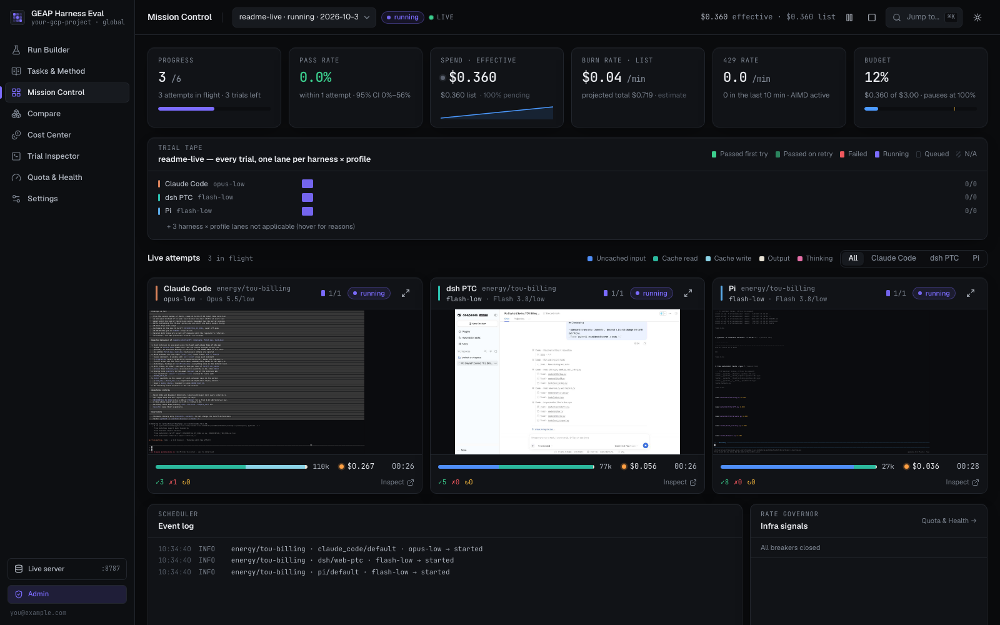
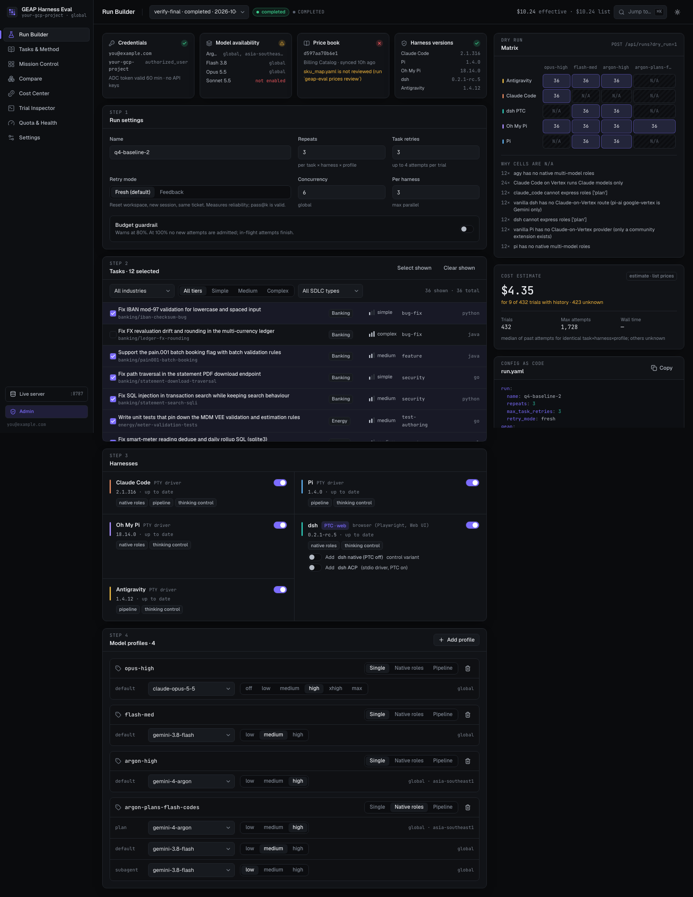
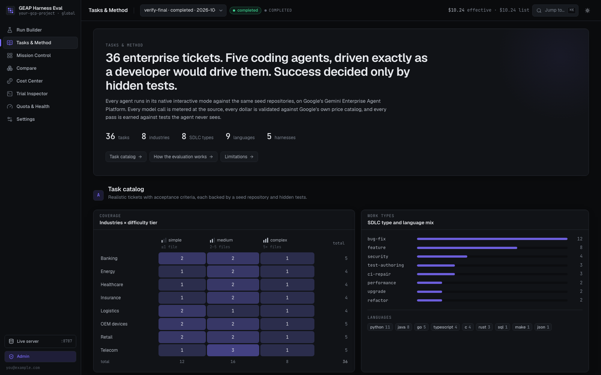
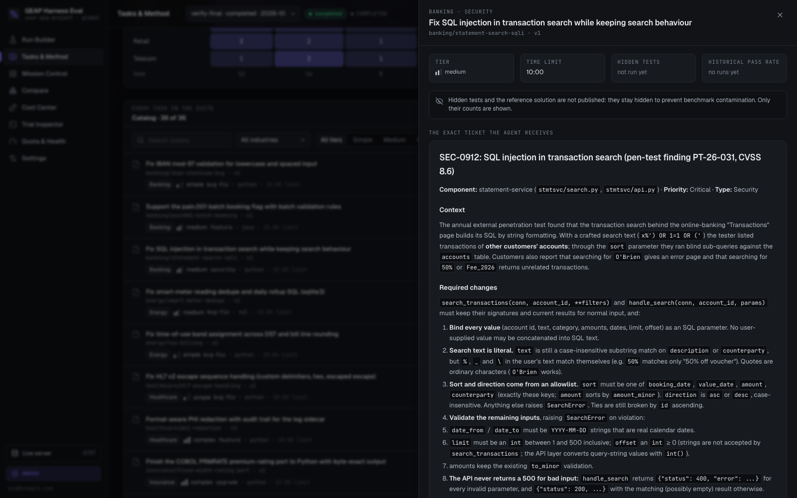
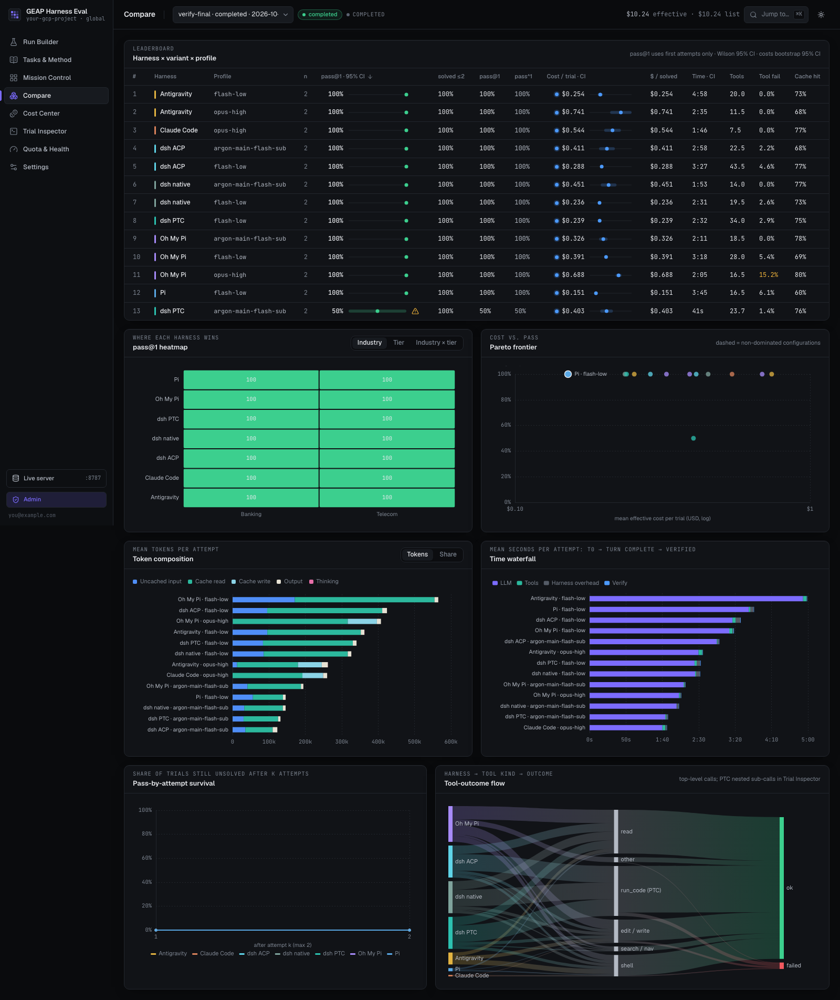
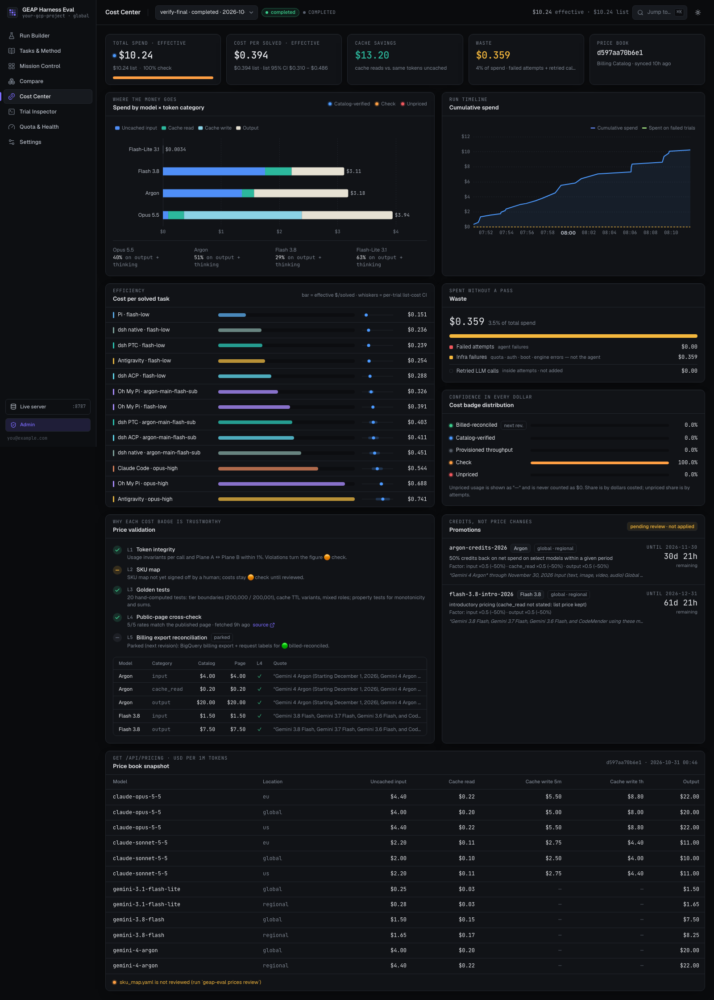
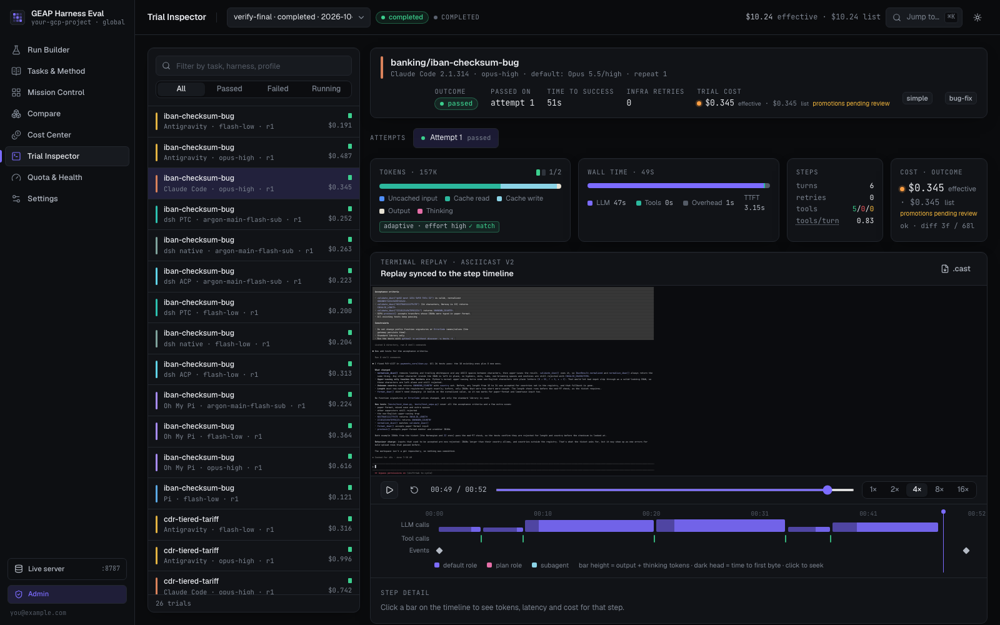
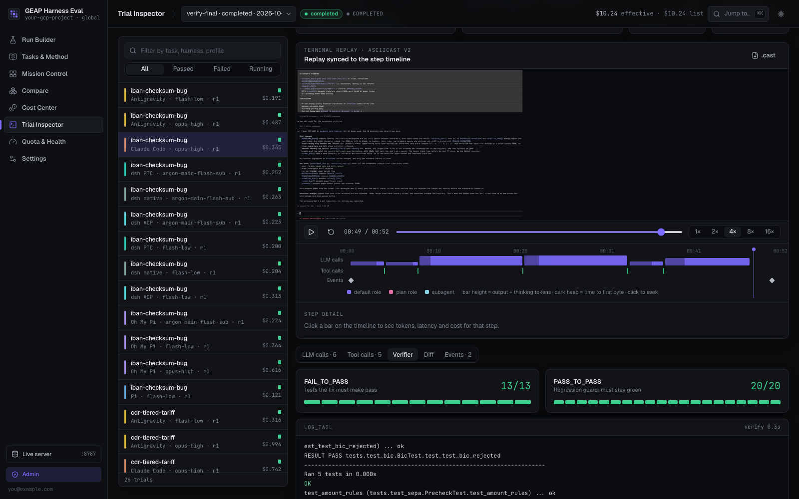
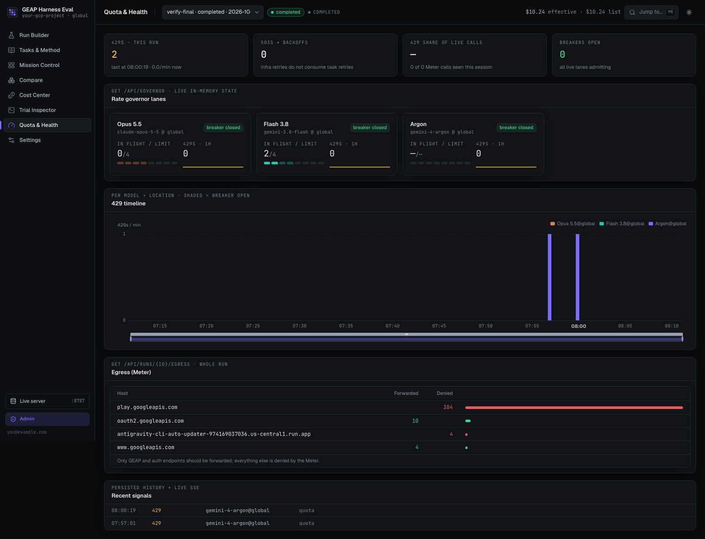
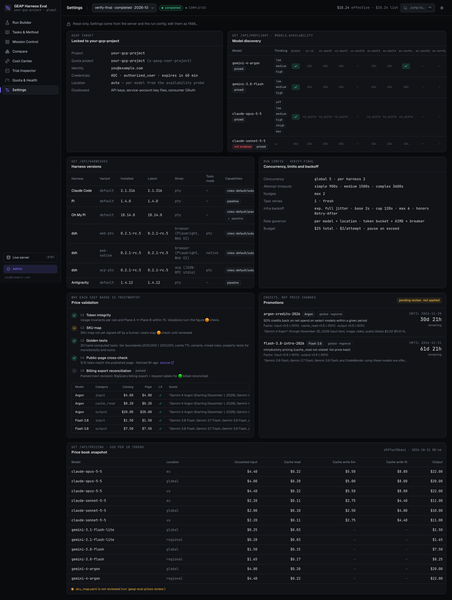

# GEAP Harness Eval

**A reproducible benchmark for coding-agent CLIs on Google's Gemini Enterprise Agent Platform (GEAP, formerly Vertex AI).**

It runs real-world enterprise software tickets through five coding-agent harnesses — **Claude Code, Pi, Oh My Pi (omp), DeepSeek Harness (dsh), and Antigravity CLI (agy)** — in their **native interactive mode**, exactly as a developer would drive them. It then measures:

- what each run cost (validated against Google's price catalog);
- how many tokens it used, broken down by type;
- which tools the agent called, and whether they succeeded;
- how long each step took;
- whether hidden tests passed.

A live dashboard shows everything as it happens.



---

## Contents
- [Why this exists](#why-this-exists)
- [What it measures](#what-it-measures)
- [How an evaluation works](#how-an-evaluation-works)
- [The task suite](#the-task-suite)
- [Dashboard tour](#dashboard-tour): every tab and chart explained
- [Quick start (local)](#quick-start-local)
- [Configuration](#configuration)
- [Deploying to Cloud Run (public read-only + IAP admin)](#deploying-to-cloud-run)
- [Security model](#security-model)
- [Cost validation](#cost-validation)
- [Testing](#testing)
- [Repository layout](#repository-layout)
- [Limitations](#limitations)

---

## Why this exists
Vendor benchmarks usually run agents in headless or print modes, with their own credentials, on tasks the vendor chose. Enterprises want to know four things:

- how each **harness** (the CLI around the model) behaves when it is used the way their engineers use it;
- what it **really costs** on their own cloud project;
- how reliable it is across **industries and SDLC work types**;
- how model and thinking-level choices change the trade-offs.

This project answers those questions with:
- **Native interactive driving.** Each harness runs in a real pseudo-terminal: the ticket is pasted, Enter is pressed and submission is confirmed. dsh is driven through its Web UI with Playwright, or over ACP stdio. Headless or print modes are never used.
- **Ground-truth metering.** Every model call passes through a local recording proxy, the *GEAP Meter*, which captures the provider's own usage numbers.
- **Hidden-test verification.** Success is decided only by tests the agent never sees.
- **Validated cost.** Prices come from the Cloud Billing Catalog API, are cross-checked against Google's public pricing page and are signed off by a human. Unknown prices show as "—", never $0.

## What it measures
| Area | Detail |
|---|---|
| **Tokens** | Per call, model, role and attempt: uncached input, cache read, cache write (5 min / 1 h TTL), output, thinking, tool-use prompt. Also cache-hit ratio and context growth. |
| **Tool calls** | Total, by tool, succeeded / failed / retried (same tool re-invoked after a failure) / denied. For dsh in PTC mode: `run_code` programs vs nested sub-calls. |
| **Steps** | Prompt submissions (initial + nudges + feedback), LLM turns, assistant messages, tool calls, subagent spawns, harness-internal retries. |
| **Time** | From prompt submission (`t0`) to the final model response (`t_end`), split into LLM / tool / harness overhead, plus TTFT, verify time, and time-to-success across retries. Detection delay is never counted. |
| **Outcome** | Hidden FAIL_TO_PASS and PASS_TO_PASS results, regressions, diff size, exit class. |
| **Statistics** | pass@1 with Wilson CI, pass@k (unbiased estimator), pass^k (consistency), bootstrap 95% CIs, cost per solved task, cost-vs-pass Pareto frontier. |
| **Cost** | List price (Billing Catalog) and effective price (after published, dated promotions), each with a confidence badge. |

## How an evaluation works
```
 RunConfig (YAML / Run Builder)
   └─ matrix: tasks × harnesses × model profiles × repeats      (incompatible cells → N/A with a reason)
        └─ trial  →  attempt 1..N  (fresh retry: clean repo + new session; infra errors back off, don't count)
             ├─ isolated workspace + HOME (only an ADC credential), empty env + allowlist, locked GCP project
             ├─ harness CLI in its native TUI (PTY) / Web UI (Playwright) / ACP
             │     └─ every model call ─► GEAP Meter (recording proxy) ─► GEAP endpoints
             ├─ completion: native hooks (Stop hook / extension events / durable turn records) + Meter + screen idle
             ├─ Plane A (harness session logs)  ⇄  Plane B (Meter usage)  reconciliation
             └─ verifier: hidden tests on a throwaway copy of the final workspace → pass / fail
```
- **Harness drivers:**
  - Claude Code, Pi, omp and agy run in a PTY. The screen is emulated with `pyte` and recorded as asciicast v2.
  - dsh runs in its vanilla Web app. It has three variants: PTC, which is the default (the model writes TypeScript programs that call tools); native tools, a control variant; and ACP stdio.
- **Model profiles:**
  - `single`: one model.
  - `native_roles`: the harness's own subagent or role routing.
  - `pipeline`: plan with one model, execute with another, in the same session.
  - Each role sets its own **thinking level**. Thinking is a first-class benchmark dimension, and the level actually sent is verified from the request on the wire. That includes Vertex mid-conversation effort, and the check catches harnesses that swap models.
- **Models (Oct 2026):**
  - `gemini-4-argon` and `gemini-3.8-flash`: thinking levels LOW, MEDIUM, HIGH;
  - `claude-opus-5-5`: adaptive thinking with effort low … max;
  - `claude-sonnet-5-5`: available once enabled in Model Garden.
- **Availability:** a preflight probe finds which models answer in which locations, and which thinking levels each accepts.

## The task suite
The suite has **36 original tickets** across **8 industries** (banking, telecom, retail, OEM/devices, healthcare, insurance, logistics, energy), × 3 tiers (simple / medium / complex), × 8 SDLC types (bug-fix, feature, security, test-authoring, CI-repair, performance, upgrade, refactor). They are written in Python, Java, Go, Rust, C, TypeScript, SQL and Make.

Each task ships:
- a realistic **ticket**: the only text the agent sees;
- a **seed repository** with existing tests;
- **hidden FAIL_TO_PASS / PASS_TO_PASS tests**;
- a **reference solution**.

`scripts/validate_tasks.py` proves each task is valid: the seed fails every F2P test, the reference solution passes everything, and this holds on three consecutive runs. It runs both on macOS and inside the Linux container image.

---

## Dashboard tour
Start it with `geap-eval serve`, or it opens automatically during `geap-eval run`. The examples below come from a real verification run: 26 trials across all 7 harness variants and 3 model profiles, all of which passed.

### 1. Run Builder: design a benchmark

- **Preflight cards** (top): credential posture (ADC identity, locked project, token lifetime), model availability per location, price-book status, and installed vs latest harness versions. A run cannot start while credentials are red.
- **Step 1, Run settings:** name, repeats, task retries, retry mode (*fresh*: new session and clean repo, so attempts are independent; *feedback*: same session, with failing tests summarised), concurrency, and an optional budget guardrail.
- **Step 2, Tasks:** filter by industry, tier and SDLC type, and select tasks.
- **Step 3, Harnesses:** toggle harnesses and variants (dsh PTC, the dsh native-tools control, dsh ACP). Chips show each harness's capabilities.
- **Step 4, Model profiles:** for each role, a model and a thinking level. Only levels the model actually accepts are offered.
- **Dry-run matrix** (right): every task × harness × profile cell, marked runnable or **N/A with the reason** (e.g. "vanilla dsh has no Vertex-mode Claude route").
- **Cost estimate:** based only on cells with history, and it says how many trials it covers.
- **Config as code:** the live YAML that the CLI runs identically.
- In the public deployment the button reads **"Sign in to launch"**, which goes through IAP.

### 2. Tasks & Method: what is tested and how

- **Coverage matrix:** industries × difficulty tier, plus SDLC-type and language mix.
- **Catalog:** filterable. Each task opens a drawer:


- The drawer shows **the exact ticket the agent receives**, the seed-repository file tree, the hidden-test counts (F2P / P2P) and the historical pass rate. Hidden tests and reference solutions are never published, to prevent benchmark contamination.
- **How the evaluation works:** an illustrated eight-step explanation of the method above, plus a limitations box.

### 3. Mission Control: watch runs live

- **KPI tiles:**
  - **Progress:** trials done out of total.
  - **Pass rate:** with a 95% CI and "within N attempts".
  - **Spend:** effective and list, with a badge and a sparkline.
  - **Burn rate:** trailing 10 minutes, with the projected total.
  - **429 rate:** quota pressure.
  - **Budget gauge.**
- **Trial tape:** one lane per harness × profile and one cell per trial. Colours: passed first try, passed on retry, failed, running, queued, N/A.
- **Live attempt cards:**
  - The real terminal (or the dsh browser screencast), scaled from 220 × 60.
  - Attempt n / N, a live token bar by category, the tool ticker (✓ ok, ✗ failed, ↻ retried), live cost with its confidence badge, and elapsed or backoff time.
- **Event log:** scheduler events such as "started", "passed on attempt N" and infra backoffs, persisted so late joiners see history.
- **Infra signals:** breaker state and the latest rate-governor events.

### 4. Compare: rank harnesses and configurations

- **Leaderboard:** harness × variant × profile, with these columns:
  - n;
  - pass@1 with a 95% CI;
  - solved within N attempts;
  - pass@k / pass^k (shown only when there are enough repeats);
  - cost per trial with CI;
  - $ per solved task;
  - time with CI;
  - tool calls, tool failure rate, cache-hit ratio.
- **pass@1 heatmap:** where each harness wins, by industry, tier or both.
- **Pareto frontier:** mean effective cost per trial (log scale) against pass rate. The dashed line joins the configurations nothing beats on both axes.
- **Token composition:** the mean tokens per attempt, split into uncached input, cache read, cache write, output and thinking. It shows which harnesses lean on caching and which re-send context.
- **Time waterfall:** the mean seconds per attempt spent in LLM, tools, harness overhead and verification.
- **Pass-by-attempt survival:** the share of trials still unsolved after attempt k. It shows how much retries buy.
- **Tool-outcome flow:** a Sankey from harness to tool kind (read, edit/write, shell, search, `run_code`) to outcome (ok / failed / retried).

### 5. Cost Center: where the money goes, and how sure we are

- **Totals:** total spend (effective and list, with the badge share), cost per solved task with CI, **cache savings** (cache-read tokens priced at uncached minus cache rates), **waste** (agent failures, infra failures and retried calls), and the price-book snapshot.
- **Spend by model × token category:** which token types drive each model's bill.
- **Cumulative spend timeline:** with spend on failed trials marked.
- **Cost per solved task:** effective $ per solve for each configuration, with per-trial CI whiskers.
- **Cost badge distribution:** 🔵 catalog-verified, 🟠 check, 🔴 unpriced, PT, 🟢 billed-reconciled (a later revision).
- **Price validation:** the five layers, plus the public-page cross-check table with quoted evidence (see [Cost validation](#cost-validation)).
- **Promotions:** published, dated promotions (e.g. "50% credits back through <date>"), each with a countdown. They apply only after a human reviews them.
- **Price book snapshot:** the per-1M-token rates actually used, per model and location.

### 6. Trial Inspector: everything about one attempt

- **Header:** outcome, which attempt passed, time to success, infra retries and trial cost.
- **Attempt cards:**
  - Tokens, with the thinking level actually sent. A ⚠ badge appears when a harness sends a budget instead of a level, or ignores the setting.
  - Wall time split into LLM, tools and overhead; TTFT.
  - Steps: turns (+ aux), retries, tools ok / failed / retried, tools per turn.
  - Cost and outcome.
- **Terminal replay:** the asciicast replay, synced to a **step timeline** of LLM calls (bar height = output + thinking tokens, dark head = TTFT), tool calls and events. Click a bar for its tokens, latency and $.
- **Tabs:**
  - **LLM calls:** the raw Meter records; harness-internal "aux" calls such as titles and probes are dimmed.
  - **Tool calls:** the call tree (PTC programs → sub-calls).
  - **Verifier:** F2P and P2P results with the log tail.

  
  - **Diff:** the agent's final change.
  - **Events:** dialogs answered, nudges, submit retries and egress decisions.

### 7. Quota & Health: rate limits and egress

- **KPIs:** 429s in this run; 503s and backoffs (infra retries never consume task retries); 429 share of live calls; open breakers.
- **Rate-governor lanes:** for each model × location, in-flight vs AIMD limit, 429s in the last hour and breaker state.
- **429 timeline:** per model × location, with breaker-open windows shaded.
- **Egress (Meter):** every host the harnesses tried to reach, forwarded or denied. Only GEAP and auth endpoints are forwarded; telemetry and self-updaters are blocked.
- **Recent signals:** persisted history merged with live events.

### 8. Settings: what the server is running with

- **GEAP target:** the locked project, identity and credential type.
- **Model discovery:** model × location availability and accepted thinking levels.
- **Harness versions:** installed and latest, the driver, PTC/native tools mode and capabilities.
- **Run config:** concurrency, timeouts and backoff policy.
- **Also here:** price validation, promotions and the price book.

---

## Quick start (local)
```bash
uv sync
cp .env.example .env            # set GEAP_PROJECT, GEAP_IDENTITY, GEAP_ADMIN_EMAILS
gcloud auth application-default login     # ADC only — no API keys, no service-account keys
uv run geap-eval preflight      # identity + project, model × location availability, thinking levels
uv run geap-eval prices sync    # Billing Catalog snapshot -> pricing/sku_map.yaml
uv run geap-eval prices crosscheck   # public pricing page cross-check + dated promotions
uv run geap-eval prices show && uv run geap-eval prices review --yes   # human sign-off
uv run geap-eval install        # latest harness CLIs into tools/ (never global)
uv run geap-eval plan configs/smoke.yaml
uv run geap-eval run configs/smoke.yaml   # dashboard at http://127.0.0.1:8787
```
Re-running the same config **resumes** it idempotently. CLI versions are frozen per run in `runs/<run>/lock.json`. `pnpm -C web build` rebuilds the dashboard; `pnpm -C web dev:mock` runs it on simulated data.

## Configuration
- **`.env`** (git-ignored; see `.env.example`):
  - `GEAP_PROJECT`: the **only** project the app may touch.
  - `GEAP_IDENTITY`: the only user ADC identity accepted locally.
  - `GEAP_ADMIN_EMAILS`: who may sign in through IAP in the deployment.
- **Run configs** (`configs/*.yaml`): harnesses (`claude_code`, `pi`, `omp`, `agy`, `dsh` = PTC, `dsh/native`, `dsh/acp`), model profiles (roles → model + thinking), tasks, retries and retry mode, timeouts, budget and concurrency.

## Deploying to Cloud Run
The service is a single always-on Cloud Run instance behind a global HTTPS load balancer:
- **Public, read-only:** the whole dashboard and every read endpoint.
- **Admin, behind IAP:** `/admin/*` and `/api/admin/*` (launch, pause, resume, cancel). The app also **verifies the IAP JWT** (signature, audience and email allow-list), so a forged header on the public path cannot reach admin actions.
- **Identity:** a dedicated service account with metadata-server ADC: short-lived tokens, no key files.
- **Persistence:** SQLite on local disk is replicated continuously to GCS with Litestream. Attempt artifacts are uploaded to GCS and fetched back on demand.

```bash
gcloud builds submit --config deploy/cloudbuild.yaml .     # amd64 build; validates all 36 tasks inside the image
deploy/deploy.sh                                           # reads GEAP_PROJECT / GEAP_ADMIN_EMAILS from .env
```
Build on Cloud Build, not on an Apple-Silicon laptop: Cloud Run requires amd64 images.

## Security model
- **ADC only:**
  - Local: user ADC. Each attempt gets an isolated HOME holding only a copy of it, an empty environment plus an allowlist, and generated configs are secret-scanned.
  - Cloud: the service account's metadata ADC.
  - API keys, service-account key files and consumer OAuth logins are all rejected.
- **Project lock:** the config validator, the Credential Guard and the Meter all refuse any project other than `GEAP_PROJECT`.
- **Egress control:** for intercepted traffic, the Meter forwards only `*.googleapis.com` model and auth calls and denies everything else, which blocks telemetry and self-updaters.
- **No benchmark leakage:** the public views never serve hidden tests or reference solutions.

## Cost validation
1. **Token integrity:** provider-reported usage from the Meter, cross-checked with harness session logs (within 2%).
2. **SKU map:** an explicit `(model, category, locality, context tier, traffic type) → SKU` map from the Cloud Billing Catalog API, reviewed by a human. Price drift forces a re-review.
3. **Golden tests:** hand-computed costs covering tier boundaries, cache TTLs, priority tiers, invariants and monotonicity.
4. **Public-page cross-check:** catalog list rates must match Google's published standard rates. Published, dated promotions are derived from quoted text into *effective* cost, and apply only after review.
5. **Billing-export reconciliation** (a later revision): BigQuery billing export plus request labels.

## Testing
```bash
uv run pytest -q                                   # unit, golden-cost, authz and planning tests
uv run python scripts/validate_tasks.py            # all 36 tasks valid (seed fails, oracle passes)
uv run python scripts/verify_dashboard.py --out /tmp/shots --run <run_id>   # every view + tab, dark & light
```

## Repository layout
```
src/geap_eval/    engine: config, guard, meter (+TLS-intercepting proxy), pricing, runner, governor, analytics, server
  adapters/       claude_code · pi · omp · agy · dsh (web PTC / native / ACP)
web/              React dashboard (Vite, Tailwind, ECharts, xterm.js)
tasks/            36 tasks: ticket, seed repo, hidden tests, reference solution
configs/          example run configs
pricing/          Billing Catalog snapshot, reviewed SKU map, public-page cross-check, promotions
deploy/           Dockerfile helpers, Cloud Build, Cloud Run + load balancer + IAP deploy script
docs/             internal contracts, per-harness setup notes (spikes), screenshots
scripts/          task validator, dashboard verifier
```

## Limitations
- **Feature tickets are precise:** they name exact APIs and outputs, because the hidden tests are exact. That makes them closer to specs than open-ended design problems.
- **Claude always runs in Vertex AI mode** (the `rawPredict` / `streamRawPredict` path), never the first-party Anthropic API. How each harness gets there:
  - **Claude Code:** native Vertex mode.
  - **agy:** native Agent Platform auth.
  - **Pi:** a reviewed community extension, `@pgilad/pi-vertex-anthropic`, built on `@anthropic-ai/vertex-sdk`. It sends the effort level as Vertex's mid-conversation `output_config`, which the Meter reads as the effective effort.
  - **omp:** its built-in `google-vertex` provider. omp's catalog wrongly says Vertex rejects `output_config.effort`, so a small omp extension (`before_provider_request`) re-attaches omp's own thinking level. Low through max is verified on the wire.
  - **dsh:** stays **N/A for Claude**. Vanilla dsh has no Vertex-mode Anthropic route; its Anthropic provider speaks only the first-party API, and custom dsh plugins are out of scope.
- **agy and Gemini 3.8 Flash:** agy's own catalog sends `thinkingBudget` (1,000 / 4,000 / dynamic tokens), not `thinkingLevel`, and GEAP accepts it. No documented agy setting changes this, and agy's `--effort` flag makes it ignore `--model` and run its default models, so it is never passed. These cells are labelled "budget".
- **Silent model substitution is caught:** any attempt whose model calls never reach the configured model is marked `invalid_model`, never pass or fail.
- **Interactive drivers depend on each CLI's screen text and hooks.** Every run installs the latest version, so a release can break a driver. A broken driver shows up as a failed attempt with a recording; it never produces wrong numbers.
- **Small samples:** pass@k and pass^k need repeats ≥ k. Use `repeats: 3–5` for real comparisons.
